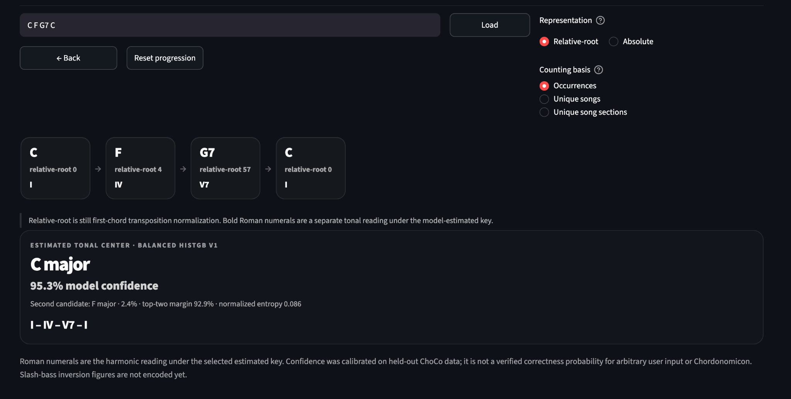
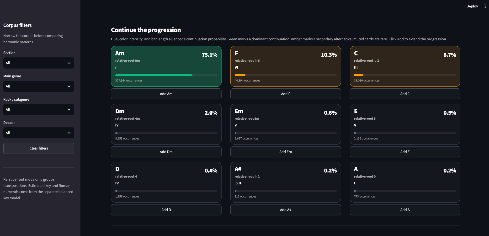
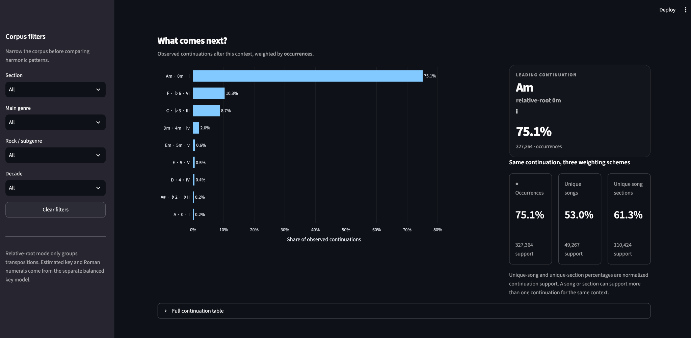

# Chordonomicon Research Explorer

A local, non-commercial research application for exploring harmonic progression patterns in the Chordonomicon v2 corpus.

The project combines corpus search, next-chord statistics, transposition-invariant progression representations, supervised key inference, probability calibration, and Roman-numeral analysis in a single offline Streamlit interface.



## What it does

- Explore chord progressions by song section, genre, subgenre, and decade.
- Compare absolute chord sequences with a transposition-invariant relative-root representation.
- Estimate empirically observed next chords from corpus frequencies.
- Compare continuation support by occurrences, unique songs, or unique song sections.
- Infer tonal center with a balanced HistGradientBoosting model.
- Display Roman-numeral interpretations under the model-estimated key.
- Run locally and offline after the required data and model artifacts have been prepared.
- Query large corpus aggregates through DuckDB while using Streamlit as the interactive front end.

## Corpus continuation explorer

The continuation view turns a progression into an empirical branching point. Candidate next chords are ranked from observed corpus support and can be added directly to the current progression.



The same continuation can also be inspected under three weighting schemes: raw occurrences, unique songs, and unique song sections.



## Key-inference pipeline

The v1 key model evaluates **24 candidate keys** for each progression: 12 major and 12 minor.

Its main design choices are:

- candidate-relative, transposition-invariant features
- HistGradientBoosting candidate ranking
- inverse-frequency true-mode weighting (`alpha = 1.0`)
- temperature scaling (`T ≈ 1.3006`)
- explicit evaluation of major/minor imbalance instead of optimizing aggregate accuracy alone

Post-hoc ChoCo test evaluation after model-selection work:

| Metric | Result |
|---|---:|
| Overall Top-1 key accuracy | 71.9% |
| Major Top-1 key accuracy | 72.4% |
| Minor Top-1 key accuracy | 69.0% |
| Balanced mode accuracy | 84.0% |

The earlier unbalanced model achieved slightly higher aggregate Top-1 accuracy but strongly underperformed on minor keys. The balanced model was selected because it substantially reduced that asymmetry.

### Confidence calibration

The model's candidate scores are converted into a 24-key probability distribution and temperature-scaled using ChoCo validation data.

These values are best interpreted as **model confidence**, not as universally verified probabilities that a prediction is correct. Calibration can shift when the model is applied to Chordonomicon or to arbitrary user-entered progressions.

## Relative-root vs. Roman numerals

The application deliberately keeps two representations separate.

**Relative-root representation** normalizes a progression to the first chord root, making transposed patterns easier to compare across the corpus.

**Roman-numeral analysis** is produced only after a tonal center has been estimated.

For example:

```text
C  F  G7  C
```

can be interpreted under C major as:

```text
I  IV  V7  I
```

This distinction matters because first-chord normalization is not the same thing as identifying a tonic.

## Architecture

```text
Chordonomicon v2 CSV
        |
        v
preprocessing / section parsing
        |
        v
DuckDB aggregate tables
        |
        +----------------------+
        |                      |
        v                      v
progression explorer      key-inference model
        |                      |
        v                      v
next-chord statistics     calibrated key estimate
        |                      |
        +----------+-----------+
                   |
                   v
           Streamlit interface
                   |
                   v
            Roman-numeral view
```

## Tech stack

- Python
- Streamlit
- DuckDB
- scikit-learn
- joblib
- Parquet
- Chordonomicon v2
- ChoCo

## Local setup

This repository intentionally does **not** include the raw Chordonomicon dataset, large DuckDB databases, full prediction Parquet files, or trained model binaries.

Create a virtual environment and install dependencies:

```bash
python3 -m venv .venv
source .venv/bin/activate
pip install -r requirements.txt
```

Place the required local data and model artifacts under `data/` according to the project documentation.

Then run:

```bash
./run.command
```

or:

```bash
streamlit run app.py
```

## Data and licensing

Chordonomicon v2 is a third-party dataset distributed under **CC BY-NC 4.0**. The dataset itself is not redistributed in this repository.

This project is intended as a personal, non-commercial research and portfolio demonstration. Dataset licensing and any underlying third-party rights should be reviewed separately before commercial reuse.

## Methodological notes

- Relative-root representation is not Roman-numeral analysis.
- Roman numerals are generated only after a key has been inferred.
- Model probabilities were calibrated on ChoCo; calibration may shift on Chordonomicon.
- Chordonomicon chord sequences should not be interpreted as duration-aware harmonic rhythm.
- Slash-bass inversion figures are not encoded yet.
- Section-level modulation detection is outside v1.
- The ChoCo evaluation reported above is post-hoc after model-selection and imbalance-diagnosis work; it should not be described as a pristine untouched final holdout.

## Repository structure

```text
.
├── app.py
├── chord_utils.py
├── db.py
├── download_data.py
├── key_inference.py
├── key_modeling/
├── preprocess.py
├── scripts/
├── tests/
├── docs/
│   └── screenshots/
├── examples/
├── requirements.txt
├── run.command
└── data/                 # local-only, ignored by Git
```

## Why this project

The project began as a corpus-based progression explorer and evolved into an end-to-end applied data-science system.

It now covers:

- large-scale data preprocessing
- SQL/DuckDB aggregation
- feature engineering
- supervised learning
- class-imbalance diagnosis
- probability calibration
- deployment-domain auditing
- interactive analytical visualization

The key modeling decision is also part of the project's story: the final classifier was not selected solely because of aggregate accuracy. Diagnostic analysis showed that the earlier model systematically favored major keys, so the final v1 model trades a small amount of aggregate Top-1 performance for substantially better major/minor balance.

That makes the project a useful example of treating model diagnostics, uncertainty, and deployment behavior as first-class parts of an applied data-science workflow.
